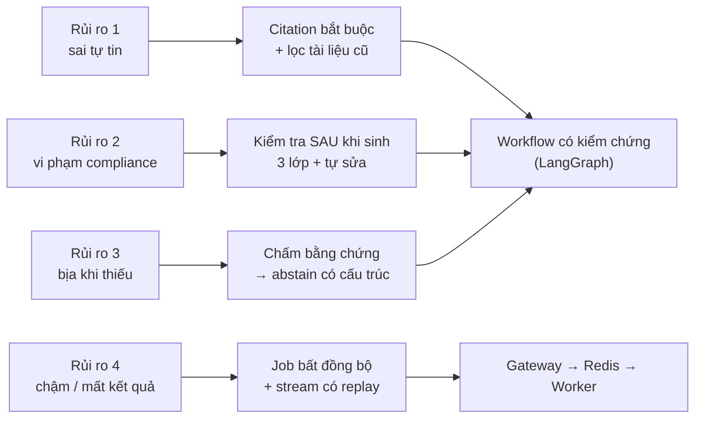

# 00 — Vì sao thiết kế theo cách này

> Đọc file này trước. Nó giải thích **mạch lập luận** dẫn tới kiến trúc; các file 01–06 là chi tiết.
> Bảng quyết định đầy đủ: [`03-key-design-decisions.md`](03-key-design-decisions.md).

---

## 1. Bắt đầu từ rủi ro, không bắt đầu từ công nghệ

Một trợ lý tri thức cho team marketing của brand skincare có thể hỏng theo 4 cách. Xếp theo mức độ thiệt hại:

| # | Cách hỏng | Thiệt hại thật |
|---|---|---|
| 1 | **Trả lời sai một cách tự tin** (giá cũ, số liệu bịa) | Team dùng số sai trong quảng cáo / trả lời khách |
| 2 | **Sinh nội dung vi phạm compliance** ("cures acne", "clinically proven" không có nghiên cứu) | Rủi ro pháp lý, bị khoá tài khoản quảng cáo |
| 3 | **Không nói "không biết"** khi KB không có thông tin | Người dùng tin vào câu trả lời bịa |
| 4 | Chậm, mất kết quả khi rớt mạng | Khó chịu, nhưng không gây hại |

→ Thứ tự ưu tiên của kiến trúc: **có nguồn → đúng compliance → biết từ chối → truy vết được → độ bền → tốc độ → UI.**
Mọi quyết định dưới đây đều quay về bảng này.

---

## 2. Sáu câu hỏi thiết kế và câu trả lời

### Q1. Agent tự do (ReAct, tool-calling) hay workflow cố định?

**Workflow có điều kiện.** Bài toán có các bước biết trước: hiểu câu hỏi → tìm → đánh giá bằng chứng → viết →
kiểm tra. Agent tự do chỉ đáng giá khi không gian hành động mở (nhiều tool, dữ liệu live) — ở đây chỉ có một
nguồn là KB. Workflow cho 3 thứ mà agent tự do không cho:

- **Kiểm tra là bước bắt buộc**, không phải thứ LLM "có thể nhớ gọi". `verify` luôn chạy trước khi trả kết quả.
- **Test được**: hàm rẽ nhánh là Python thuần (`edges.py`), test bằng state dựng tay, không tốn tiền LLM.
- **Chi phí và độ trễ đoán được**: vòng lặp có trần (≤ 2 lần tìm lại, ≤ 2 lần sửa) → graph luôn kết thúc.

LLM vẫn ra quyết định — nhưng chỉ về **nội dung** (intent, query, bằng chứng nào liên quan) qua structured
output, không về **luồng điều khiển**.

### Q2. Làm sao để câu trả lời có nguồn và không dùng thông tin cũ?

- Model chỉ được viết từ khối `<sources>`, mỗi khẳng định gắn marker `[S#]`.
- `verify` bắt **deterministic**: marker trỏ tới nguồn không tồn tại, hoặc dòng có số (giá, %, cỡ mẫu) mà không có nguồn.
- `finalize` đổi `[S#]` → `[1]`, `[2]` bằng code, không để LLM tự đánh số.
- Tài liệu cũ bị **loại ở tầng truy xuất** (`supersedes` → `status=superseded` → filter trong Qdrant), không trông
  chờ LLM tự chọn giá mới. Đây là nguyên tắc chung: **cái gì làm được bằng code thì không giao cho prompt.**
- Hybrid search (dense + BM25): BM25 bắt tên sản phẩm, mã rule chính xác; dense bắt ngữ nghĩa và câu hỏi tiếng Việt.

### Q3. Làm sao để không vi phạm compliance?

Prompt **không** đủ — LLM có thể bỏ qua, và người dùng có thể yêu cầu thẳng "viết là chữa mụn". Nên dùng 3 lớp:

1. **Prompt**: rules luôn được nạp vào system prompt (không phụ thuộc việc retrieval có tìm thấy policy hay không).
2. **Regex theo field** chạy sau khi sinh: chỉ kiểm phần sẽ được đăng (hook, copy), không kiểm mục `do_not_say`
   (nơi buộc phải nhắc lại từ cấm). Kèm điều kiện ngữ cảnh: "clinically proven" chỉ hợp lệ nếu product sheet
   được trích dẫn có nghiên cứu.
3. **LLM verifier** bắt diễn đạt né regex — nhưng bản thân verifier cũng bị kiểm: đoạn trích phải có thật trong
   văn bản, `rule_id` phải tồn tại, mức độ lấy từ `rules.yaml` chứ không tin LLM.

Có lỗi → `revise` tối đa 2 lần → vẫn lỗi thì trả `needs_review` với confidence `low` thay vì giả vờ đạt.
Rules là **dữ liệu** (`rules.yaml`): pháp chế sửa rule không cần sửa code.

### Q4. Làm sao để hệ thống biết nói "không biết"?

Ba tín hiệu độc lập, vì mỗi cái riêng lẻ đều có điểm mù:

| Tín hiệu | Bắt được | Điểm mù nếu dùng riêng |
|---|---|---|
| Cosine tuyệt đối < 0.30 | KB hoàn toàn không có gì liên quan | Có tài liệu "gần chủ đề" nhưng không trả lời câu hỏi |
| LLM chấm bằng chứng (sufficient / partial / insufficient) | "Có chính sách ship nội địa nhưng không có EU" | LLM có thể chấm lỏng |
| Độ phủ loại tài liệu (artifact) | Brief thiếu research hay learnings | — |

Khi từ chối, không trả "Tôi không biết" trống trơn mà trả khối **Đã tìm thấy / Còn thiếu / Gợi ý** — vẫn hữu
ích. **Confidence tính bằng code** từ kết quả chấm + verify + số lần sửa, không hỏi LLM "bạn chắc bao nhiêu %".

### Q5. Vì sao gateway → Redis → worker thay vì một API gọi LLM trực tiếp?

Một lượt có thể mất 10–40 giây và gọi LLM 5–8 lần. Gọi đồng bộ trong request HTTP thì F5 là mất kết quả, worker
chết là mất request, không giới hạn được số job chạy song song.

| Yêu cầu | Cách đáp ứng |
|---|---|
| Rớt mạng / F5 vẫn xem tiếp | Mỗi job một Redis Stream; SSE gửi `id`; client gửi lại `Last-Event-ID` để replay |
| Mở SSE sau khi worker đã chạy không lỡ event | Stream đọc lại được từ đầu (Redis Pub/Sub thì mất) |
| Bấm gửi 2 lần không tạo 2 job | `Idempotency-Key` + Lua script nguyên tử |
| Scale xử lý AI độc lập | `make scale n=3`; gateway không đổi |
| Gateway không có quyền gọi model | Gateway không có OpenAI key, không import code AI (CI kiểm bằng import-linter) |

Vẫn stream token để UX nhanh — nhưng **chỉ với Q&A**. Brief không stream nội dung vì có thể bị copy đi chạy
quảng cáo trước khi kiểm tra xong.

### Q6. Làm sao chứng minh nó đúng (testable)?

- **Golden set 28 case** gồm 6 bẫy cố ý cài vào dữ liệu mẫu (giá cũ, EU, "cures acne", hai nghiên cứu mâu thuẫn,
  prompt injection trong review, câu bắt buộc của SPF).
- `make eval` chấm recall@5, citation validity, abstain precision/recall, số vi phạm compliance, rubric brief —
  **dưới ngưỡng thì exit 1**. Đổi prompt hay model phải qua đây.
- Không có fake LLM (ADR-0017): test hành vi trên model thật, assert theo tính chất chứ không so chuỗi.

---

## 3. Những thứ cố ý KHÔNG làm (và vì sao)

| Không làm | Lý do |
|---|---|
| Tool-calling / MCP trong luồng chính | Không có dữ liệu live cần tool; thêm bất định mà không thêm giá trị |
| PostgreSQL, LiteLLM, Langfuse trong bản demo | Mỗi thành phần phải gắn với một yêu cầu của đề; bản demo ưu tiên chất lượng graph và eval. Đã thiết kế sẵn đường lên ([06](06-production-architecture.md)) và ranh giới code để thay không phải viết lại (`llm/client.py` là điểm duy nhất tạo model; `worker/store.py` là điểm duy nhất ghi kết quả) |
| Fine-tune / reranker | KB 17 tài liệu, recall@5 đã đạt ngưỡng; reranker nằm trong roadmap khi KB lớn |
| UI cầu kỳ | Đề không chấm UI; UI chỉ cần **cho thấy** được citation, các bước agent, abstain, compliance |

---

## 4. Tóm tắt một câu

> Rủi ro lớn nhất là **sai một cách tự tin** và **vi phạm compliance**, nên hệ thống là một **workflow có kiểm
> chứng** — mọi câu trả lời phải có nguồn, đi qua kiểm tra sau khi sinh, và được phép nói "không đủ thông tin" —
> chạy trong **worker bất đồng bộ** để bền và stream được, với **eval có ngưỡng** để chứng minh điều đó.
