# 01 — Architecture (hiện trạng)

> Mô tả **những gì đang chạy trong repo**.
> Bản production đề xuất: [`06-production-architecture.md`](06-production-architecture.md).
> Đi sâu vào agent: [`02-agentic-graph.md`](02-agentic-graph.md).

---

## 1. Tổng quan (Level 0 — 5 khối lớn)

Company Brain Assistant là trợ lý tri thức nội bộ cho brand DTC giả định **Lumi Botanics**. Toàn hệ thống chỉ có
**5 khối**, đọc từ trái sang phải:

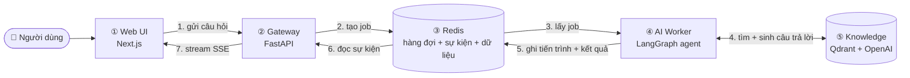

| Khối | Một câu mô tả |
|---|---|
| ① Web UI | Giao diện chat; gửi câu hỏi, nhận câu trả lời dạng stream, hiển thị citation / artifact |
| ② Gateway | "Cửa vào" duy nhất: xác thực, tạo job, đẩy sự kiện về browser. **Không** gọi LLM |
| ③ Redis | "Bưu điện" giữa gateway và worker: hàng đợi job, luồng sự kiện mỗi job, và lưu hội thoại |
| ④ AI Worker | Nơi agent chạy: hiểu câu hỏi → tìm → viết → kiểm tra compliance → trả kết quả |
| ⑤ Knowledge | Qdrant chứa kiến thức đã index; OpenAI để embed và sinh văn bản |

Vì sao tách như vậy: gateway và worker **không gọi nhau trực tiếp**, chỉ nói chuyện qua Redis → worker chết hay
browser F5 thì job và sự kiện vẫn còn, scale worker độc lập với gateway.

---

## 2. Bên trong từng khối (Level 1)

### 2.1 ① Web UI — `apps/web`

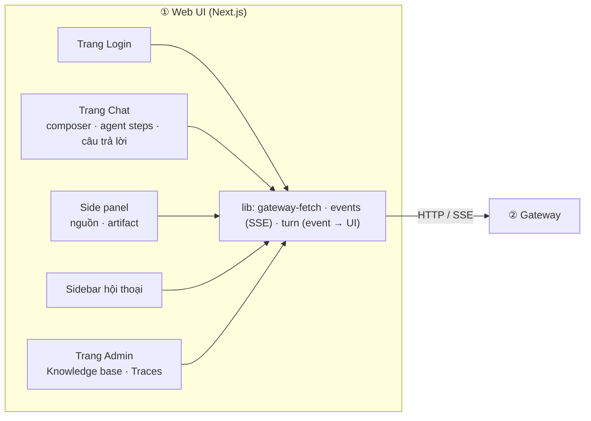

| Thành phần | Việc |
|---|---|
| `lib/gateway-fetch.ts` | Gắn header `Authorization` cho mọi request, 401 → về `/login` |
| `lib/events.ts` | Đọc SSE bằng `fetch` (cần header auth nên không dùng `EventSource`), hỗ trợ `Last-Event-ID` |
| `lib/turn.ts` | Ánh xạ event → trạng thái một lượt chat (token, steps, sources, final) — có test Vitest |
| `components/chat/*` | Citation hover, badge confidence/compliance, artifact panel, feedback 👍/👎 |

### 2.2 ② Gateway — `apps/gateway`

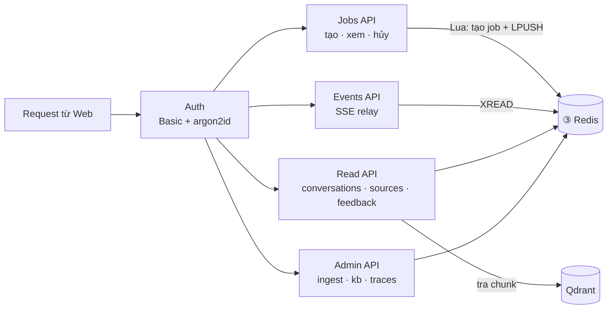

| Thành phần | Endpoint | Ghi chú |
|---|---|---|
| Auth | mọi route | `users.yaml` + mật khẩu từ env, cache verify 5 phút |
| Jobs API | `POST /v1/jobs`, `GET /v1/jobs/{id}`, `POST /v1/jobs/{id}/cancel` | `Idempotency-Key` bắt buộc → bấm 2 lần không tạo 2 job |
| Events API | `GET /v1/jobs/{id}/events` | Replay từ đầu / từ `Last-Event-ID`, heartbeat 15 s, tự phát hiện job kẹt |
| Read API | `/v1/conversations…`, `/v1/sources/{chunk_id}`, `/v1/messages/{id}/feedback` | Lọc theo `user_id`, trả 404 thay vì 403 |
| Admin API | `/admin/ingest`, `/admin/kb`, `/admin/traces` | Chỉ role `admin` |

### 2.3 ③ Redis — nhóm dữ liệu

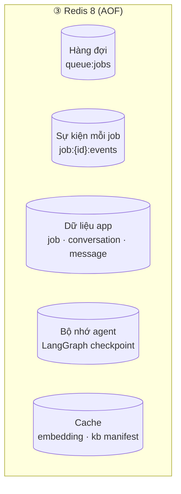

Chi tiết từng key: [mục 5](#5-data-model-redis-là-nguồn-sự-thật-duy-nhất-ở-bản-demo).

### 2.4 ④ AI Worker — `apps/ai-service`

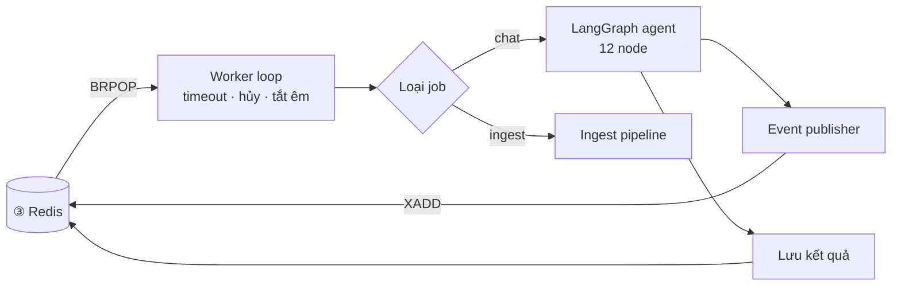

Bên trong `LangGraph agent` có 4 module hỗ trợ:

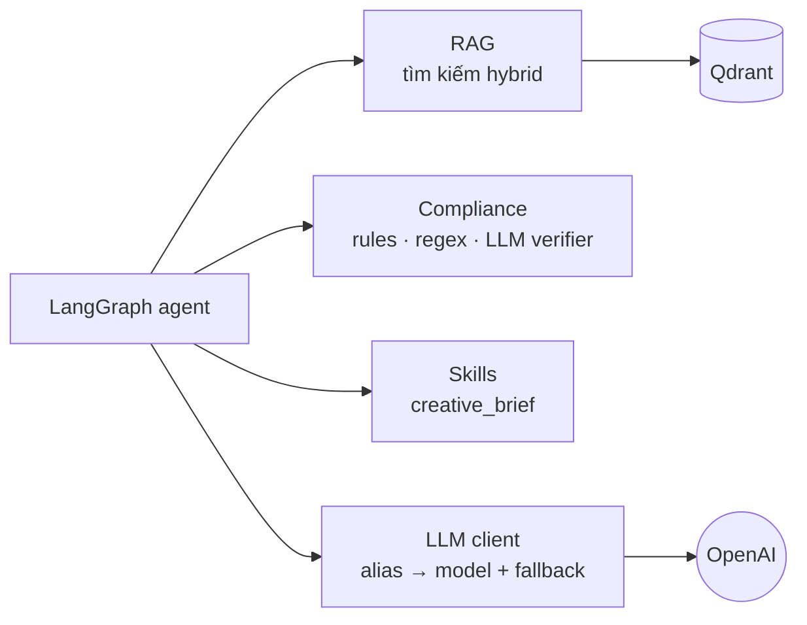

| Module | Code | Việc |
|---|---|---|
| Worker loop | `worker/loop.py` | N task song song (`WORKER_CONCURRENCY=4`), timeout 180 s, SIGTERM chờ 25 s |
| Handlers | `worker/handlers.py` | Chạy graph, chuyển stream LangGraph → event hệ thống |
| Publisher | `worker/publisher.py` | Gộp token mỗi ~50 ms trước khi ghi Redis |
| Agent | `agent/` | 12 node — xem [`02-agentic-graph.md`](02-agentic-graph.md) |
| RAG | `rag/` | Hybrid dense + BM25, dựng context có citation `S1..Sn`, ingest |
| Compliance | `compliance/` | Rule từ `data/compliance/rules.yaml` |
| Skills | `skills/` | Mỗi loại artifact là một folder |
| LLM client | `llm/client.py` | Điểm **duy nhất** tạo model; alias trong `config/models.yaml` |

### 2.5 ⑤ Knowledge — Qdrant + OpenAI + Ingest

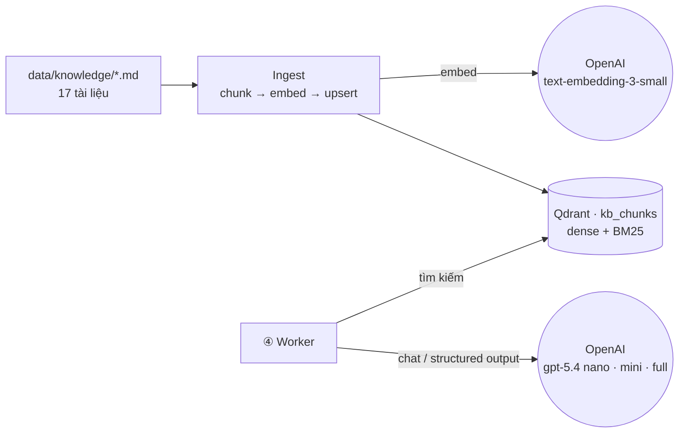

### 2.6 Bảng công nghệ

| Service | Công nghệ | Code |
|---|---|---|
| `web` | Next.js 16, Tailwind, TanStack Query, `eventsource-parser` | `apps/web` |
| `gateway` | FastAPI, redis-py async, sse-starlette, argon2 | `apps/gateway` |
| `ai-worker` + `ingest` | LangGraph, langchain-openai, qdrant-client, fastembed (BM25), structlog | `apps/ai-service` |
| `redis` | Redis 8 (AOF `everysec`, `noeviction`, 1 GB) | — |
| `qdrant` | Qdrant 1.17 (API key) | — |
| `packages/shared` | Pydantic: contracts, Redis keys, Lua script, UUIDv7 — không business logic | `packages/shared` |

Ranh giới được CI kiểm bằng `import-linter`: `gateway` ⟂ `ai_service`; `shared` không import app;
`ai_service.agent` không biết Redis/worker; chỉ `ai_service.llm` import `langchain_openai`.

---

## 3. Luồng xử lý

### 3.1 Một lượt chat — nhìn ở mức khối

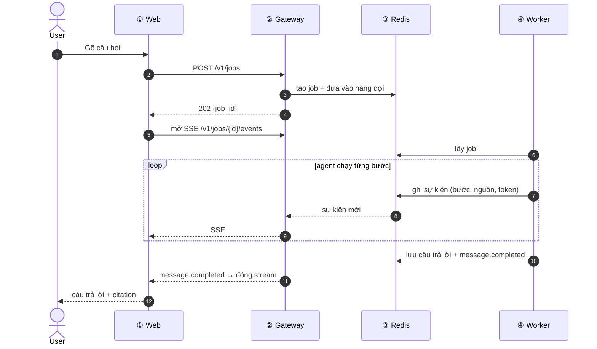

### 3.2 Bên trong ④ Worker cho một job chat

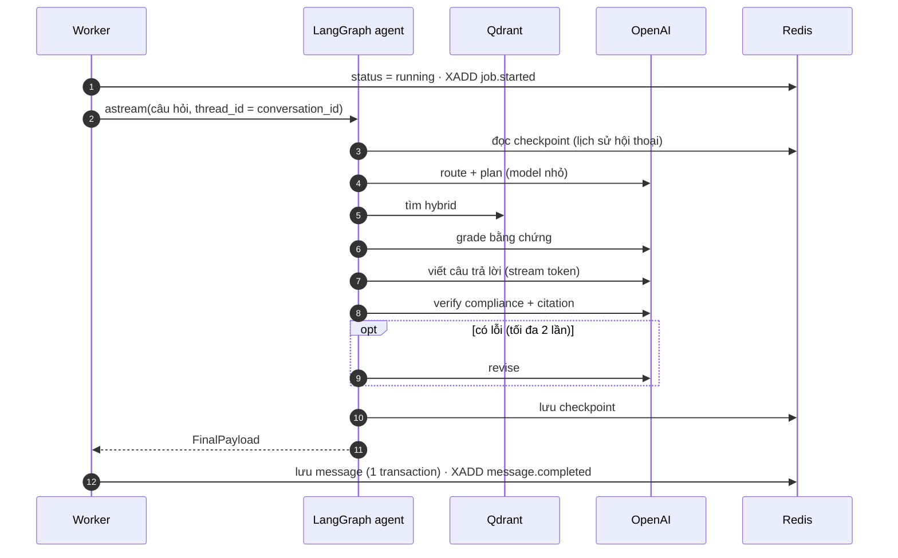

Chi tiết từng lệnh Redis (Lua `create_job`, `XREAD BLOCK`, kiểm tra cờ hủy mỗi 200 ms…) nằm trong code
`gateway/api/jobs.py`, `gateway/api/events.py`, `worker/handlers.py`.

### 3.3 Sequence — rớt mạng / F5 giữa lúc stream

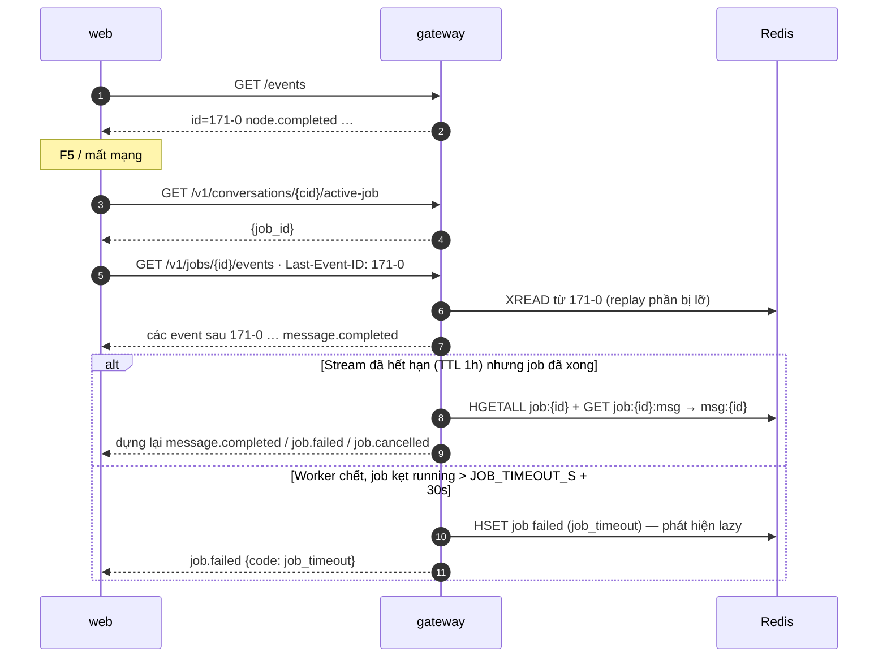

### 3.4 Sequence — hủy job

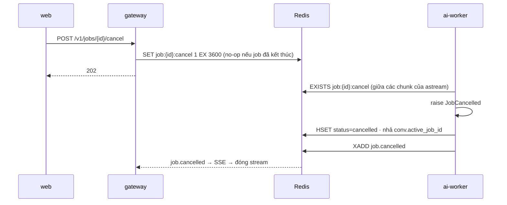

### 3.5 Sequence — ingest knowledge base

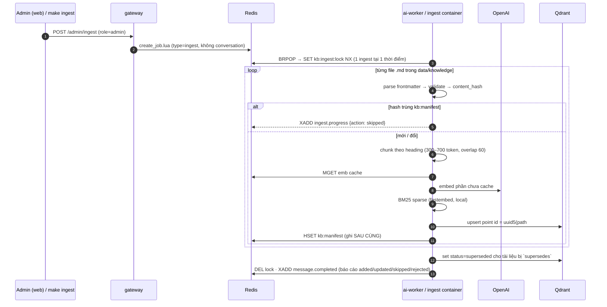

### 3.6 Vòng đời job

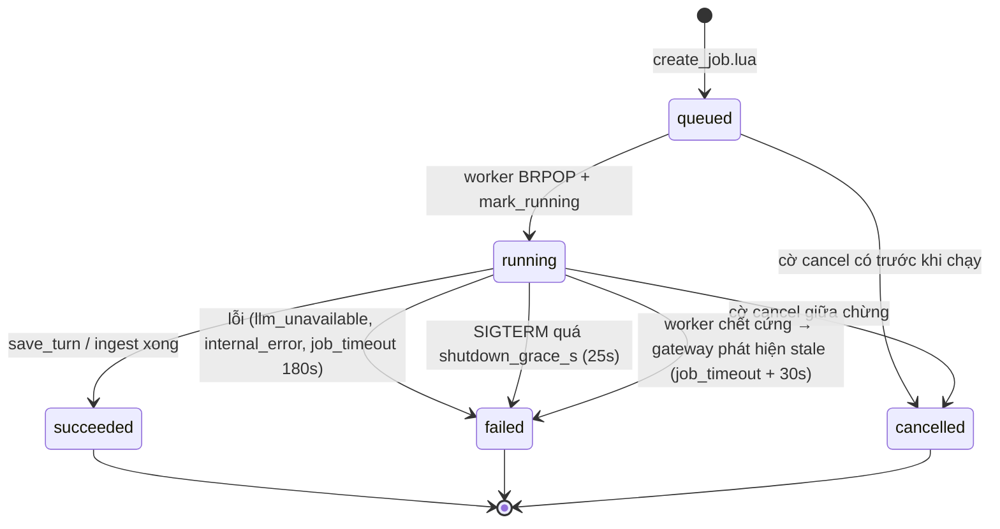

---

## 4. Event protocol (SSE)

Mỗi frame có `id` = ID entry Redis Stream → client chỉ cần gửi lại `Last-Event-ID`.
Envelope: `{"v":1, "job_id", "ts", "data"}` (`shared.contracts.events`).

| Event | Phát bởi | Ý nghĩa ở UI |
|---|---|---|
| `job.started` | handler | Bắt đầu chạy |
| `node.started` / `node.completed` | node (`emit`) / handler (`updates`) | Danh sách "agent steps" có `label`, `detail`, `duration_ms` |
| `route.decided` | `route` | Intent + doc_types |
| `retrieval.sources` | `retrieve`, sau `grade_evidence` (đánh số lại) | Panel nguồn S1..Sn |
| `token` | `generate_answer`, `revise` | Bản nháp Q&A (artifact **không** stream token) |
| `verification.result` | `verify` | Badge compliance, danh sách issue |
| `answer.revised` | `revise` | UI thay bản nháp bằng bản sửa |
| `artifact.ready` | `finalize` | Panel artifact (JSON + Markdown) |
| `ingest.progress` | ingest handler | Thanh tiến độ trang KB |
| `message.completed` | handler | **Kết quả chính thức** (`FinalPayload`) — terminal |
| `job.failed` / `job.cancelled` | worker / gateway | Terminal |
| `heartbeat` | gateway (mỗi 15 s khi không có event) | Giữ kết nối qua proxy |

---

## 5. Data model (Redis là nguồn sự thật duy nhất ở bản demo)

| Key | Kiểu | Nội dung | TTL |
|---|---|---|---|
| `queue:jobs` | LIST | job_id chờ xử lý (LPUSH / BRPOP) | — |
| `job:{id}` | HASH | `user_id, conversation_id, type, status, input, created_at, started_at, finished_at, error` | 7 ngày |
| `job:{id}:events` | STREAM | Event của job | 1 giờ sau khi kết thúc |
| `job:{id}:cancel` | STRING | Cờ hủy | 1 giờ |
| `job:{id}:msg` | STRING | id message assistant của job | 7 ngày |
| `idem:{uid}:{key}` | STRING | job_id (idempotency) | 24 giờ |
| `user:{uid}:jobs` / `user:{uid}:convs` | ZSET | Danh sách theo thời gian | 7 / 30 ngày |
| `conv:{cid}` | HASH | `user_id, title, updated_at, active_job_id` | 30 ngày |
| `conv:{cid}:msgs` | LIST | message id theo thứ tự | 30 ngày |
| `msg:{id}` | STRING (JSON) | Message + citations, confidence, artifact, compliance, steps, feedback | 30 ngày |
| `checkpoint:*` | (langgraph-checkpoint-redis) | State graph theo `thread_id = conversation_id` | 30 ngày |
| `emb:{model}:{sha256}` | STRING (float32 bytes) | Cache embedding | 7 ngày |
| `kb:manifest` | HASH | `source_path → {content_hash, chunk_count, status, …}` | — |
| `traces:recent`, `trace:{job_id}` | ZSET / STRING | Đọc bởi trang admin Traces (**chưa có writer** — xem limitations) | — |

Qdrant collection `kb_chunks`: point id `uuid5(source_path#ordinal)`, vectors `dense` (1536, cosine) + `bm25`
(sparse, IDF), payload `chunk_id, source_path, title, doc_type, section, content, effective_date, version,
status, product_id, has_clinical_studies, token_count`.

---

## 6. Cấu trúc repo

```text
apps/
  web/                 Next.js UI
  gateway/             FastAPI: api/ (routers) · core/ (auth, errors, redis, middleware) · services/
  ai-service/
    agent/             graph.py · state.py · edges.py · nodes/ · prompts/*.md · schemas.py · confidence.py
    rag/               retriever.py · context_builder.py · citations.py · qdrant_store.py · sparse.py · ingest/
    compliance/        rules.py · deterministic.py · llm_checker.py
    skills/            registry.py · creative_brief/ (SKILL.md, schema.py, retrieval_plan.yaml, rubric.yaml, render.md.j2)
    llm/               client.py (điểm duy nhất tạo model) · config.py · embed_cache.py
    worker/            loop.py · handlers.py · publisher.py · jobs.py · store.py · step_details.py
packages/shared/       contracts/ · redis_keys.py · lua/create_job.lua · ids.py
config/                models.yaml (alias → model) · pricing.yaml
data/                  knowledge/ (17 tài liệu .md) · compliance/rules.yaml · users.yaml
evals/                 golden_set.jsonl (28 case) · run_eval.py · judges.py · thresholds.yaml
.github/workflows/     ci.yml
```
