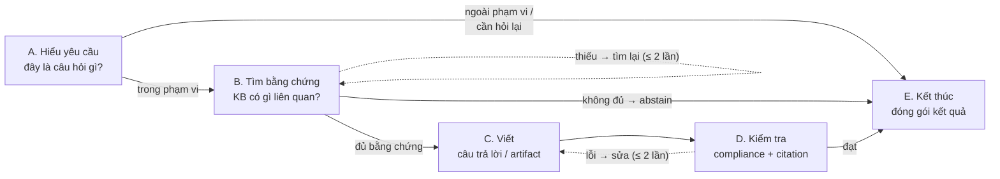
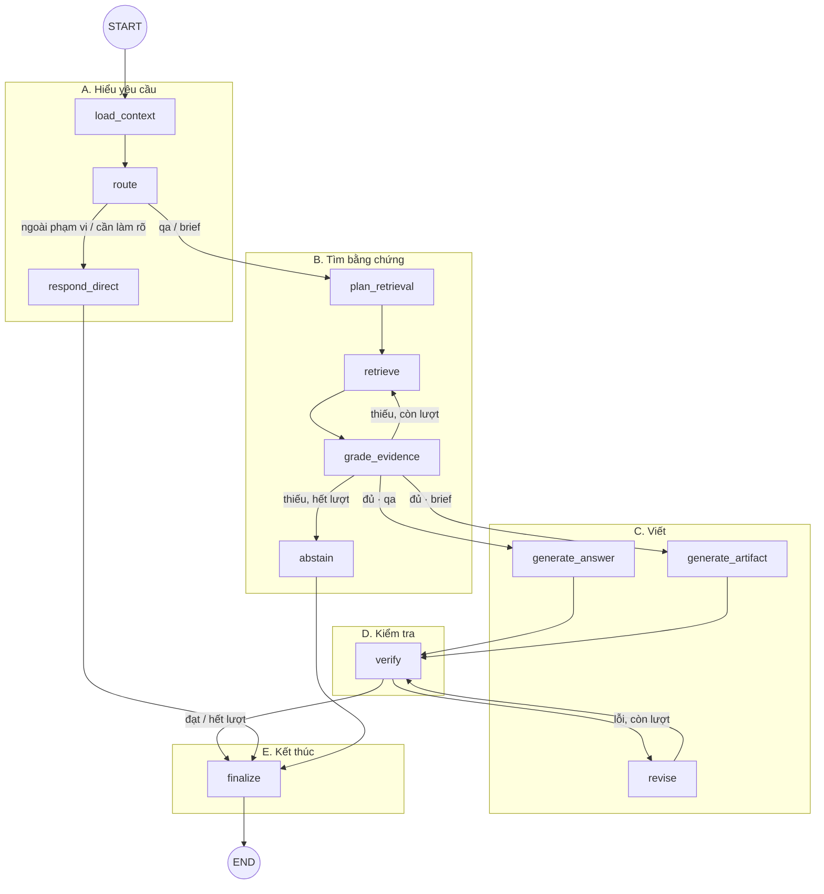
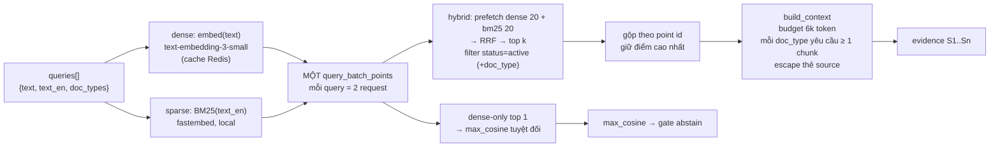
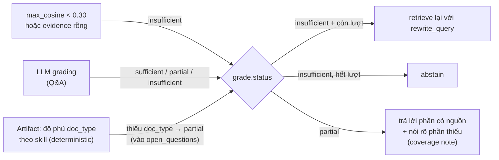

# 02 — Agentic graph (LangGraph) — đi sâu

> Code: `apps/ai-service/src/ai_service/agent/`. Graph được build trong `graph.py::build_graph`, chạy bởi
> `worker/handlers.py::handle_chat`, debug trực tiếp bằng `python -m ai_service.cli`.

---

## 1. Loại agent: workflow có điều kiện, không phải ReAct

Bài toán có các bước biết trước (hiểu câu hỏi → tìm → đánh giá bằng chứng → viết → kiểm tra), nên graph là một
**corrective-RAG workflow** với 2 vòng lặp có giới hạn — không có tool-calling tự do. LLM chỉ quyết định
*nội dung* ở từng bước (qua structured output), còn *luồng điều khiển* do hàm Python thuần (`edges.py`) quyết.

| Thuộc tính | Giá trị |
|---|---|
| Số node | 12 (9 gọi LLM, 3 deterministic) |
| Vòng lặp | `grade_evidence → retrieve` ≤ 2 lần truy xuất · `verify → revise → verify` ≤ 2 lần sửa |
| Bộ nhớ | Checkpoint Redis (`AsyncRedisSaver`), `thread_id = conversation_id`, giữ 6 lượt gần nhất |
| Runtime context | `RunContext(job_id, user_id, mode, locale)` — bất biến trong một lần chạy |
| Tách khỏi hạ tầng | Node không biết Redis: phát event bằng `get_stream_writer()`; retriever được inject (`SearchBackend` Protocol) |

---

## 2. Sơ đồ graph

### 2.1 Level 0 — 5 giai đoạn của một lượt



| Giai đoạn | Node | Câu hỏi giai đoạn trả lời |
|---|---|---|
| A. Hiểu yêu cầu | `load_context`, `route`, `respond_direct` | Hỏi đáp, soạn brief, hay ngoài phạm vi? |
| B. Tìm bằng chứng | `plan_retrieval`, `retrieve`, `grade_evidence`, `abstain` | Tìm gì, ở đâu, tìm được có đủ để trả lời không? |
| C. Viết | `generate_answer`, `generate_artifact`, `revise` | Viết chỉ từ nguồn, có marker `[S#]` |
| D. Kiểm tra | `verify` | Có vi phạm rule, có claim thiếu nguồn không? |
| E. Kết thúc | `finalize` | Đổi `[S#]` → `[n]`, tính confidence, trả `FinalPayload` |

### 2.2 Level 1 — 12 node, nhóm theo giai đoạn



Loại của từng node (chi tiết ở [mục 4](#4-từng-node)):

| Nhóm | Node | Ghi chú |
|---|---|---|
| Deterministic (không LLM) | `load_context`, `respond_direct`, `finalize` | Hàm Python thuần |
| LLM nhỏ `chat-fast` | `route`, `plan_retrieval`, `grade_evidence`, `abstain` | Structured output |
| LLM vừa `chat-default` | `generate_answer`, `verify`, `revise` (Q&A) | Có stream token |
| LLM lớn `chat-strong` | `generate_artifact`, `revise` (artifact) | Không stream |
| Hạ tầng | `retrieve` | Qdrant hybrid, `RetryPolicy` ×3 |

Ba "lối ra" của một lượt — đều đi qua `finalize` để có cùng một `FinalPayload`:

| Lối ra | `status` | Confidence |
|---|---|---|
| `respond_direct` | `out_of_scope` / `clarification` | — |
| `abstain` | `abstained` | — (UI hiện khối "Không đủ thông tin") |
| `verify → finalize` | `answered` / `partial` / `needs_review` | `high` / `medium` / `low` |

---

## 3. State

`AgentState` (`state.py`) là `TypedDict`, mọi giá trị là JSON thuần (dùng `model_dump`) để checkpoint serialize
an toàn.

| Field | Phạm vi | Ghi bởi | Đọc bởi |
|---|---|---|---|
| `messages` (reducer `add_messages`) | **Nhiều lượt** | input, `load_context` (xoá cũ), `finalize` (AIMessage) | `history()` ở route/plan/generate |
| `requested_mode` | lượt | input, `load_context` | `route` |
| `question` | lượt | `load_context` → `plan_retrieval` (câu standalone) | hầu hết node |
| `route` | lượt | `route` | edges, mọi node có nhánh artifact |
| `queries`, `plan_slots` | lượt | `plan_retrieval`, `grade_evidence` (rewrite) | `retrieve` |
| `retrieval_attempts` | lượt | `retrieve` | `after_grade` |
| `evidence`, `max_cosine` | lượt | `retrieve`, `grade_evidence` (lọc + đánh số lại S1..Sn) | grade, generate, verify, revise, finalize |
| `grade` | lượt | `grade_evidence` | `after_grade`, generate (coverage note), abstain, finalize |
| `draft_md` / `artifact` | lượt | generate_*, revise, abstain, respond_direct | verify, finalize |
| `verification`, `revision_count` | lượt | `verify`, `revise` | `after_verify`, finalize |
| `outcome`, `abstain` | lượt | respond_direct, abstain | finalize |
| `final` | lượt | `finalize` | handler (đọc qua `graph.aget_state`) |

**Vì sao có `TURN_RESET`:** checkpoint mang toàn bộ state của lượt trước sang. `load_context` trả về
`TURN_RESET` để xoá sạch field theo lượt — nếu không, lượt 2 có thể dùng nhầm `evidence`/`verification`
của lượt 1.

---

## 4. Từng node

| # | Node | Model alias | Input chính | Output | Fallback khi LLM lỗi |
|---|---|---|---|---|---|
| 1 | `load_context` | — | `messages`, `RunContext.mode` | reset state, `question`, xoá message ngoài 13 tin gần nhất | — (fail fast nếu `rules.yaml` hỏng) |
| 2 | `route` | `chat-fast` | câu hỏi + 6 lượt lịch sử | `RouteDecision{intent, doc_types, product_refs, needs_clarification}` | `intent=qa`. Nếu user chọn mode khác `auto` → ép intent; skill chưa cài → `qa` |
| 3 | `respond_direct` | — | `route` | template out-of-scope / câu hỏi làm rõ | — |
| 4 | `plan_retrieval` | `chat-fast` | câu hỏi + lịch sử | câu **standalone** (giải đại từ "nó"), 1–3 query `{text, text_en, doc_types}`, slot `product/channel/category` | 1 query = câu hỏi gốc |
| 5 | `retrieve` | `embed` | `queries` | `evidence` (S1..Sn, ≤ 6k token), `max_cosine` | `RetryPolicy(max_attempts=3)` cho lỗi hạ tầng tạm thời (Qdrant 5xx, Redis, timeout) |
| 6 | `grade_evidence` | `chat-fast` | evidence + câu hỏi | `EvidenceGrade{status, relevant_sids, covered/missing_aspects, rewrite_query}` | dựa `max_cosine`: ≥ 0.45 sufficient, còn lại partial |
| 7 | `generate_answer` | `chat-default` (stream) | system prompt (+rules), lịch sử, `<sources>`, coverage note | `draft_md` có marker `[S#]` | fallback model `chat-strong` |
| 8 | `generate_artifact` | `chat-strong` (nostream) | `SKILL.md`, field publishable, `<sources>` | `artifact` (JSON theo `skill.schema`), chuẩn hoá `[S#]` → `source_ids` | — |
| 9 | `verify` | `chat-default` | draft/artifact, rules, sources | `VerificationReport{passed, issues[], llm_checked}` | LLM lỗi → chỉ dùng kết quả deterministic, `llm_checked=false` |
| 10 | `revise` | `chat-default` (Q&A, stream) / `chat-strong` (artifact) | issues + draft + sources | `draft_md` / `artifact` mới, `revision_count+1`; phát `answer.revised` | — |
| 11 | `abstain` | `chat-fast` | evidence liên quan + `missing_aspects` | khối **Đã tìm thấy / Còn thiếu / Gợi ý** | template từ `missing_aspects` |
| 12 | `finalize` | — | toàn bộ state | `FinalPayload`: resolve `[S#]` → `[n]`, confidence, compliance summary, `artifact_md` (Jinja) | — |

### 4.1 Hàm định tuyến (`edges.py`) — hàm thuần, test bằng state dựng tay

```python
MAX_RETRIEVAL_ATTEMPTS = 2
MAX_REVISIONS = 2

after_route  : out_of_scope | needs_clarification → respond_direct ; còn lại → plan_retrieval
after_grade  : insufficient → (attempts < 2 và có rewrite_query ? retrieve : abstain)
               còn lại → intent ∈ ARTIFACT_INTENTS ? generate_artifact : generate_answer
after_verify : passed hoặc revision_count ≥ 2 → finalize ; còn lại → revise
```

---

## 5. Retrieval bên trong `retrieve`



- **k**: 8 cho Q&A, 14 cho artifact (cần nhiều section: product, audience, voice, rules, learnings).
- **Tài liệu bị thay thế** (`supersedes` trong frontmatter) có `status=superseded` → bị filter, nên giá cũ
  `$38` không bao giờ vào context.
- **Song ngữ**: `text` (có thể tiếng Việt) đi nhánh dense đa ngôn ngữ; `text_en` do `plan_retrieval` sinh đi nhánh
  BM25 (KB tiếng Anh).
- **Artifact**: ngoài query của LLM, skill bổ sung query theo `retrieval_plan.yaml` (một query cho mỗi section,
  có điền slot `{product} {channel} {category}`).
- **Luôn có ≥ 1 query không lọc `doc_type`**: LLM lọc sai không được làm mất bằng chứng.

---

## 6. Ba tín hiệu abstain



Confidence **không do LLM tự chấm** (`confidence.py`):

| Điều kiện | Confidence |
|---|---|
| abstained / clarification / out_of_scope | `None` |
| Còn lỗi `block` sau 2 lần revise | `low` (status `needs_review`) |
| grade `sufficient` và 0 lần revise | `high` |
| Còn lại (partial, hoặc revise ≥ 1 lần mới pass) | `medium` |

---

## 7. Compliance — ba lớp phòng thủ

| Lớp | Ở đâu | Cách làm |
|---|---|---|
| 1. Prompt | `system.md` render kèm `rules_prompt()` ở mọi node sinh nội dung | Rule luôn được nạp, không phụ thuộc retrieval |
| 2. Deterministic | `compliance/deterministic.py` trong `verify` | Regex theo **field publishable** (artifact) hoặc văn bản Q&A đã bỏ trích dẫn/blockquote/code; `required_phrase` (CMP-003 testimonial, CMP-005 SPF); trần giảm giá 25% (CMP-006); điều kiện theo ngữ cảnh: "clinically proven" chỉ hợp lệ khi product sheet **được trích dẫn** có `clinical_studies` |
| 3. LLM verifier | `compliance/llm_checker.py` (`chat-default`) | Một lời gọi kiểm cả compliance diễn đạt khác lẫn claim không có nguồn. **Grounding chống ảo giác verifier**: `excerpt` phải thực sự có trong nội dung, `rule_id` phải tồn tại, `severity` lấy từ `rules.yaml` chứ không tin LLM |

Cộng thêm kiểm tra citation: marker `[S#]` không tồn tại → `invalid_citation`; dòng có số (giá, %, cỡ mẫu,
ngày) mà không có `[S#]` → `missing_citation`; field `CITED_FIELDS` của artifact phải có `source_ids` hợp lệ.

Issue `block` → `revise` (tối đa 2 lần); `warn` chỉ hiện cảnh báo.

---

## 8. Skills pattern (output hữu ích)

```text
skills/creative_brief/
  SKILL.md              hướng dẫn cho LLM (cấu trúc, quality bar)
  schema.py             Pydantic schema = structured output; khai báo CITED_FIELDS, publishable_fields, required_phrase_field
  retrieval_plan.yaml   query theo section, doc_types bắt buộc, max_context_tokens
  rubric.yaml           tiêu chí cho LLM judge trong eval
  render.md.j2          JSON → Markdown cho panel artifact / tải .md
```

`registry.py` tự phát hiện folder → thêm loại output mới (`insight_summary`, `campaign_recommendation`,
`compliance_review` đã có trong `Intent`) **không phải sửa graph**. Intent artifact mà chưa có skill → rơi về `qa`.

`do_not_say` chứa chính từ bị cấm → chỉ kiểm tra field **publishable** để không báo nhầm.

---

## 9. Streaming từ graph ra event

`handle_chat` gọi `graph.astream(stream_mode=["custom", "messages", "updates"])` — **lớp duy nhất** biết chuyển
stream LangGraph thành event hệ thống:

| Stream mode | Nguồn | Thành event |
|---|---|---|
| `custom` | `emit()` trong node | `node.started`, `route.decided`, `retrieval.sources`, `verification.result`, `answer.revised`, `artifact.ready` |
| `messages` | token LLM | `token` — **chỉ** khi `langgraph_node ∈ {generate_answer, revise}`; mọi structured output gắn tag `nostream` |
| `updates` | node hoàn tất | `node.completed {label, detail, duration_ms}` (+ `retrieval.sources` mới sau grade) |

Mâu thuẫn stream ↔ verify được xử lý theo loại output: Q&A stream bản nháp ngay rồi `answer.revised` nếu phải
sửa; artifact chỉ stream *tiến trình*, nội dung chỉ xuất hiện sau khi đã verify. `message.completed` luôn là
kết quả chính thức.

---

## 10. Độ tin cậy trong graph

| Cơ chế | Chỗ |
|---|---|
| Retry lỗi hạ tầng tạm thời | `RetryPolicy(max_attempts=3, retry_on=is_transient)` trên `retrieve` |
| Retry LLM | OpenAI SDK `max_retries=2` (backoff) — tầng retry LLM **duy nhất**, tránh nhân retry |
| Fallback model | `chat-fast → chat-default → chat-strong` qua `with_fallbacks` (1 bước, không lồng) — `config/models.yaml` |
| Fallback khi structured output lỗi | route → `qa`; plan → câu hỏi gốc; grade → theo cosine; abstain → template; verifier → deterministic-only |
| Vòng lặp có trần | 2 retrieve, 2 revise → graph luôn kết thúc |
| Timeout | `asyncio.wait_for(JOB_TIMEOUT_S=180)` ở worker |
| Prompt injection từ tài liệu | Nội dung trong `<source>` là dữ liệu, thẻ đóng giả bị escape; rules đứng trước; verify chạy sau sinh |

---

## 11. Test & eval của graph

| Tầng | File |
|---|---|
| Unit (không LLM) | `tests/unit/test_edges.py`, `test_confidence.py`, `test_finalize.py`, `test_compliance.py`, `test_citations.py`, `test_context_builder.py`, `test_load_context.py`, `test_skills.py` |
| Graph (LLM thật, `-m llm`) | `tests/graph/test_graph.py`, `test_traps.py` (6 bẫy demo), `test_memory.py` (đa lượt) |
| Eval | `evals/golden_set.jsonl` (28 case) → `make eval`; ngưỡng trong `evals/thresholds.yaml`: recall@5 ≥ 0.9, citation validity = 1.0, abstain P/R ≥ 0.9, compliance violations = 0, rubric artifact ≥ 4.0, p95 Q&A ≤ 12 s |
