# 06 — Production architecture & lộ trình cải thiện

> Từ hiện trạng ([`01-architecture.md`](01-architecture.md)) lên production trên AWS:
> PostgreSQL · LiteLLM · Langfuse · Prometheus + Grafana + Loki · GitHub Actions CI/CD · Amazon EKS · S3 ·
> NGINX + Route 53.

---

## 0. Thay đổi so với hiện trạng

| Hạng mục | Hiện tại (demo) | Production |
|---|---|---|
| Lưu trữ app + hội thoại | Redis (TTL 30 ngày) | **PostgreSQL (Amazon RDS)** — nguồn sự thật |
| Checkpoint LangGraph | `AsyncRedisSaver` | `AsyncPostgresSaver` (cùng RDS, schema riêng) |
| Queue | Redis LIST `LPUSH/BRPOP` (không ack) | Redis **Streams + consumer group** (`XREADGROUP/XACK/XAUTOCLAIM`) + DLQ, job ghi qua **transactional outbox** |
| Redis | Container, nguồn sự thật | **ElastiCache (Valkey/Redis OSS)** — chỉ transport + cache (queue, event stream, idempotency, rate limit, embedding cache) |
| Gọi model | `ChatOpenAI` trực tiếp, `pricing.yaml` = 0 | **LiteLLM Proxy**: alias, fallback, retry, virtual key, budget, **tính chi phí** |
| Tracing | Chưa có (`TODO(P0)`) | **Langfuse v3**: trace = job, session = conversation, span = node, generation = LLM call |
| Metrics | Không | **Prometheus + Grafana** (kube-prometheus-stack) |
| Logs | JSON ra stdout | **Grafana Alloy → Loki (S3)**, xem trong Grafana |
| Knowledge base | File mount | **S3** (versioning) → event → job ingest |
| Vector DB | Qdrant container | Qdrant StatefulSet trên EKS (EBS gp3, snapshot → S3) hoặc Qdrant Cloud |
| Chạy | Docker Compose local | **Amazon EKS**, worker scale bằng **KEDA** theo độ dài queue |
| Biên | Port `127.0.0.1` | **Route 53 → NLB → NGINX** (TLS, SSE tuning, rate limit) |
| Auth | Basic Auth, `users.yaml` | **OIDC** (Google Workspace / Cognito), session cookie httpOnly |
| CI/CD | CI lint/test + smoke trên `main` | CI cho PR + **CD**: build → ECR → staging → (approve) → production |

---

## 1. Sơ đồ khối production

### 1.1 Level 0 — 6 khối lớn

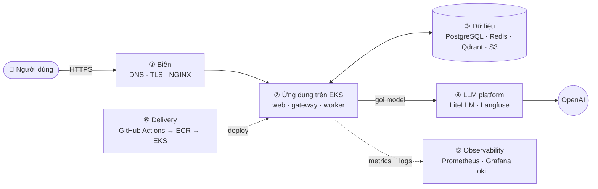

| Khối | Vai trò một câu | Chi tiết |
|---|---|---|
| ① Biên | Đưa request từ Internet vào cluster an toàn, giữ được SSE | [§8](#8-nginx--tên-miền--cần-cấu-hình-gì-thêm) |
| ② Ứng dụng | 3 service hiện tại + outbox relay, chạy trên EKS, worker tự scale | [§7](#7-amazon-eks--scale-worker-lưu-trữ-s3) |
| ③ Dữ liệu | Postgres là nguồn sự thật; Redis chỉ còn transport/cache; Qdrant là index; S3 lưu file | [§2](#2-postgresql--tầng-app-và-tầng-conversation), [§7.2](#72-s3) |
| ④ LLM platform | LiteLLM quản lý model + chi phí; Langfuse trace toàn bộ luồng | [§3](#3-litellm--quản-lý-model-và-chi-phí), [§4](#4-langfuse--tracing-full-flow) |
| ⑤ Observability | Metrics, dashboard, alert, log tập trung | [§5](#5-observability--prometheus-grafana-logging) |
| ⑥ Delivery | CI cho PR, CD lên staging → production | [§6](#6-cicd-trên-github-actions) |

### 1.2 Level 1 — bên trong từng khối

**① Biên**

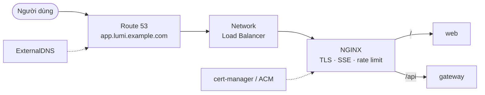

**② Ứng dụng trên EKS**

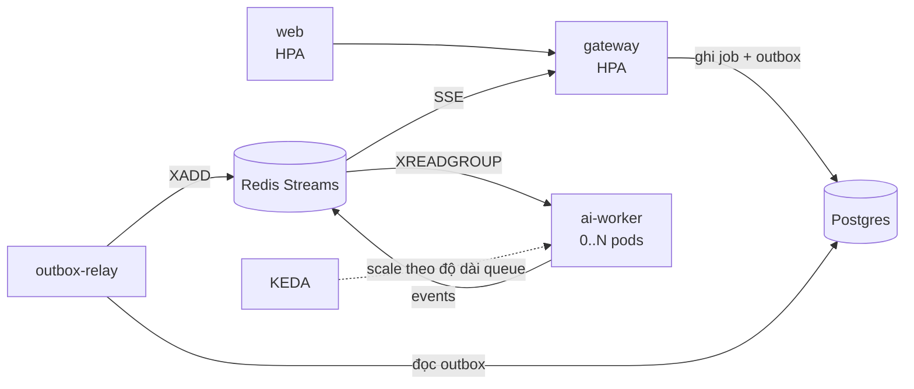

**③ Dữ liệu**

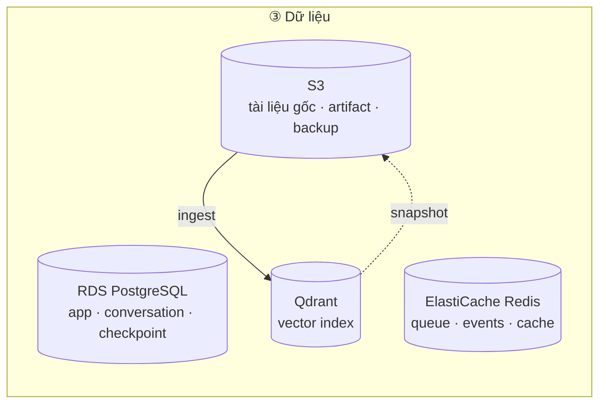

**④ LLM platform**

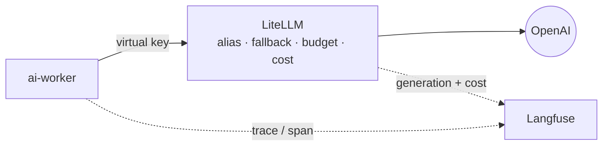

**⑤ Observability**

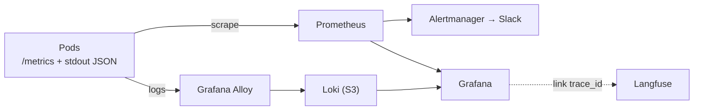

**⑥ Delivery**

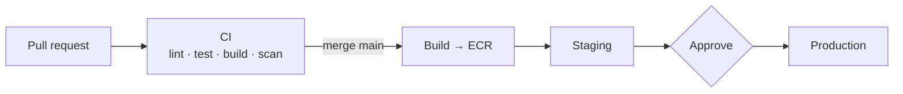

### 1.3 Vai trò từng lớp

| Lớp | Thành phần | Ghi chú |
|---|---|---|
| Biên | Route 53, NLB, NGINX, cert-manager/ACM, ExternalDNS | Một domain cho app (same-origin `/api` → không cần CORS), một domain nội bộ cho ops |
| Ứng dụng | web, gateway, ai-worker, outbox-relay | Stateless; state ở RDS/ElastiCache/Qdrant |
| LLM platform | LiteLLM, Langfuse | Có thể dùng Langfuse Cloud để bớt vận hành ClickHouse |
| Dữ liệu | RDS PostgreSQL, ElastiCache, Qdrant, S3 | RDS là nguồn sự thật; Qdrant dựng lại được từ RDS + S3 |
| Observability | Prometheus, Alertmanager, Grafana, Loki, Alloy | Một Grafana cho metrics + logs (+ link sang Langfuse theo `job_id`) |
| Delivery | GitHub Actions, ECR, Helm (sau này ArgoCD) | OIDC, không có AWS key dài hạn trong GitHub |

---

## 2. PostgreSQL — tầng app và tầng conversation

### 2.1 Phân chia database trên cùng một RDS instance

| Database | Owner | Nội dung |
|---|---|---|
| `app` — schema `app` | gateway, worker | Users, roles, documents, chunks registry, ingest runs, compliance rule versions, audit log, outbox |
| `app` — schema `conv` | gateway, worker | Conversations, messages, citations, artifacts, jobs, feedback |
| `app` — schema `lg` | worker | Checkpoint LangGraph (`langgraph-checkpoint-postgres`, bảng do `saver.setup()` tạo) |
| `litellm` | LiteLLM | Virtual keys, budgets, spend logs |
| `langfuse` | Langfuse | Metadata (project, user, prompt); event/observation nằm ở ClickHouse |

Mỗi DB/schema một role riêng, quyền tối thiểu. Kết nối qua **RDS Proxy** (worker scale nhiều pod →
nhiều connection).

### 2.2 ERD

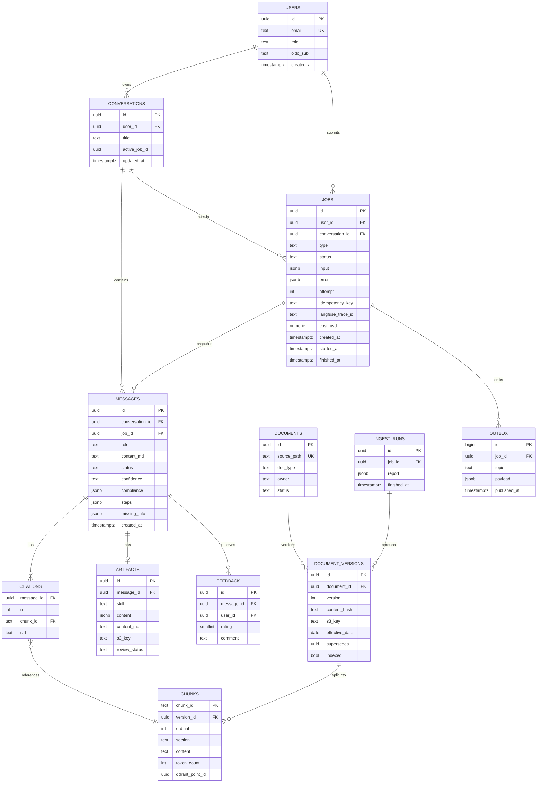

### 2.3 Transactional outbox thay cho Lua

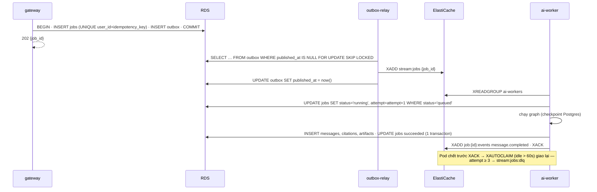

Idempotency chuyển từ `idem:*` (Redis) sang unique constraint trong Postgres; Redis vẫn giữ event stream
(SSE replay) và cache.

### 2.4 Thay đổi code

- `worker/store.py`, `worker/jobs.py`, `gateway/services/*`: Redis → SQLAlchemy async (asyncpg) + repository.
- `main.py`: `AsyncRedisSaver` → `AsyncPostgresSaver` (`langgraph-checkpoint-postgres`).
- `worker/loop.py`: `BRPOP` → `XREADGROUP` + `XACK` + `XAUTOCLAIM` + DLQ.
- Alembic migration chạy bằng Helm `pre-install,pre-upgrade` hook Job.

---

## 3. LiteLLM — quản lý model và chi phí

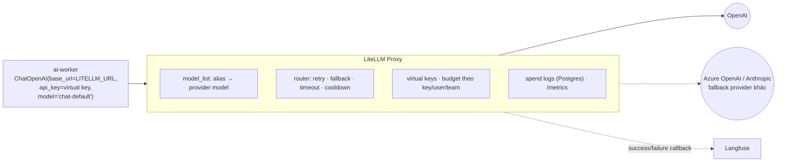

`infra/litellm/config.yaml` (thay `config/models.yaml` + `pricing.yaml`):

```yaml
model_list:
  - model_name: chat-fast
    litellm_params: { model: openai/gpt-5.4-nano, api_key: os.environ/OPENAI_API_KEY, timeout: 20, max_tokens: 800 }
  - model_name: chat-default
    litellm_params: { model: openai/gpt-5.4-mini, api_key: os.environ/OPENAI_API_KEY, timeout: 45, max_tokens: 1500 }
  - model_name: chat-strong
    litellm_params: { model: openai/gpt-5.4, api_key: os.environ/OPENAI_API_KEY, timeout: 90, max_tokens: 4000 }
  - model_name: embed
    litellm_params: { model: openai/text-embedding-3-small, api_key: os.environ/OPENAI_API_KEY }

router_settings:
  num_retries: 2
  fallbacks: [{ chat-fast: [chat-default] }, { chat-default: [chat-strong] }]
  allowed_fails: 3
  cooldown_time: 30

litellm_settings:
  success_callback: ["langfuse"]   # hoặc tắt nếu worker đã trace generation (tránh trùng)
  callbacks: ["prometheus"]

general_settings:
  master_key: os.environ/LITELLM_MASTER_KEY
  database_url: os.environ/LITELLM_DATABASE_URL
```

| Việc | Cách làm |
|---|---|
| Đổi model / provider | Sửa `model_list`, rollout LiteLLM — không build lại worker |
| Tính chi phí | LiteLLM tự tính theo bảng giá model; worker truyền `user=<user_id>` và `metadata={job_id, conversation_id, node}` → spend logs theo user/job/node; cộng dồn vào `jobs.cost_usd` |
| Budget | Virtual key riêng cho `ai-worker` và `ingest`; `max_budget` theo user (`/customer/new`), vượt → 429 → gateway trả `budget_exceeded` |
| Bảo mật key | `OPENAI_API_KEY` **chỉ** có trong LiteLLM (Secrets Manager → ESO); worker chỉ có virtual key |
| Retry | Bỏ `max_retries=2` + `with_fallbacks` trong `llm/client.py`, để LiteLLM là tầng retry/fallback duy nhất |

Thay đổi code chỉ ở `llm/client.py` (điểm duy nhất tạo model): thêm `base_url`, đổi `model=alias`.

---

## 4. Langfuse — tracing full flow

### 4.1 Mô hình dữ liệu trace

| Khái niệm Langfuse | Map tới |
|---|---|
| Session | `conversation_id` |
| User | `user_id` |
| Trace | một job (`trace_id` lưu vào `jobs.langfuse_trace_id`, trả về UI để admin mở) |
| Span | mỗi node LangGraph (route, plan_retrieval, retrieve, grade, generate, verify, revise, finalize) |
| Generation | mỗi lời gọi LLM (model, prompt, token, cost) |
| Score | `confidence`, `verify.passed`, `revision_count`, `abstained`, `max_cosine`, feedback 👍/👎 của user |
| Tags / metadata | `mode`, `intent`, `git_sha`, `prompt_version`, `skill` |

### 4.2 Luồng tracing xuyên service

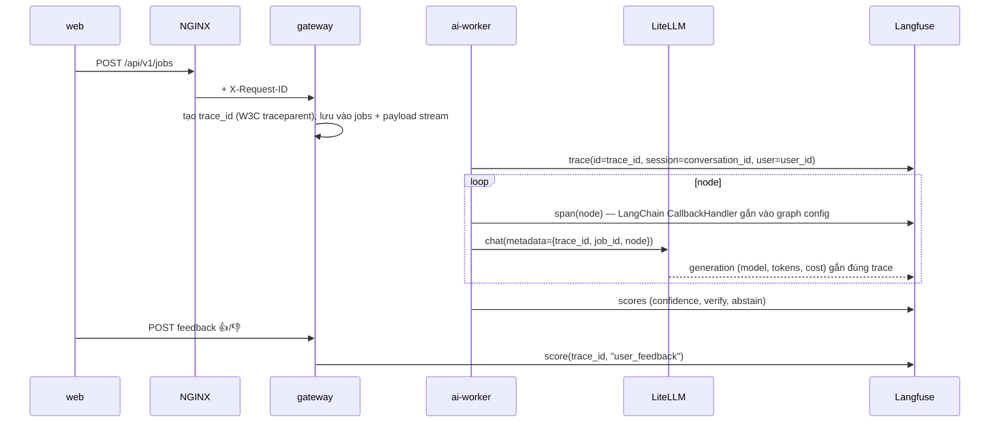

Triển khai: `langfuse.langchain.CallbackHandler` truyền vào `config["callbacks"]` của `graph.astream` trong
`handle_chat` (node không phải sửa). Mask PII trước khi gửi; `TRACE_PAYLOADS=false` ở production nếu chính
sách dữ liệu yêu cầu. Trang admin "Traces" hiện tại chuyển sang link sâu tới Langfuse.

Thêm: Langfuse **Prompt Management** cho `agent/prompts/*.md` (version + A/B), **Datasets** = `evals/golden_set.jsonl`
để chạy eval trên Langfuse, online eval lấy mẫu traffic thật.

---

## 5. Observability — Prometheus, Grafana, logging

### 5.1 Metrics (Prometheus)

| Nguồn | Metric chính |
|---|---|
| gateway (`prometheus-fastapi-instrumentator`) | `http_requests_total{route,status}`, latency histogram, `jobs_created_total{mode}`, `sse_connections` (gauge), `rate_limited_total` |
| ai-worker (`prometheus_client`, port 9100) | `jobs_processed_total{type,status}`, `job_duration_seconds{type}`, `node_duration_seconds{node}`, `retrieval_max_cosine` (histogram), `verify_issues_total{kind,rule_id}`, `revisions_total`, `abstain_total`, `llm_fallback_total{alias}` |
| Queue | `queue_length`, `xpending`, `dlq_length` (redis-exporter) |
| LiteLLM | `litellm_spend_metric`, token theo model, latency, lỗi provider |
| NGINX / Qdrant / RDS / ElastiCache | exporter có sẵn / CloudWatch exporter |

Dashboard Grafana: **Golden signals** (RPS, error, p95), **Agent quality** (abstain rate, verify fail theo rule,
confidence phân bố, max_cosine), **Cost** (USD/ngày theo model, theo user), **Queue** (length, lag, worker pods).

Alert (Alertmanager → Slack): queue lag > 60 s trong 5 phút · DLQ > 0 · `job.failed` rate > 5% · p95 Q&A > 12 s ·
spend/ngày > ngưỡng · `abstain_total` tăng đột biến (thường do ingest hỏng) · Qdrant/RDS down.

### 5.2 Logging — gợi ý

**Khuyến nghị: Grafana Loki + Grafana Alloy, lưu chunk trên S3.**

| Phương án | Ưu | Nhược | Khi nào chọn |
|---|---|---|---|
| **Loki + Alloy** (chọn) | Cùng Grafana với metrics; rẻ (index theo label, dữ liệu trên S3); log JSON structlog query bằng LogQL (`{app="ai-worker"} \| json \| job_id="…"`); nhảy từ panel metric sang log | Full-text search chậm hơn OpenSearch | Mặc định cho stack này |
| CloudWatch Logs (Fluent Bit) | Không phải vận hành gì | Đắt khi log nhiều; tách khỏi Grafana | Team nhỏ, ít log |
| OpenSearch / ELK | Full-text search mạnh | Nặng, đắt vận hành | Cần điều tra log phức tạp, SIEM |

Quy ước: log JSON một dòng (đã có), label Loki chỉ gồm `namespace, app, level` (cardinality thấp);
`job_id`, `user_id`, `request_id`, `trace_id` nằm trong nội dung JSON. Không log nguyên văn prompt (đã có trong
Langfuse). Grafana có data link từ `trace_id` trong log sang Langfuse. (Promtail đã deprecated → dùng Alloy.)

---

## 6. CI/CD trên GitHub Actions

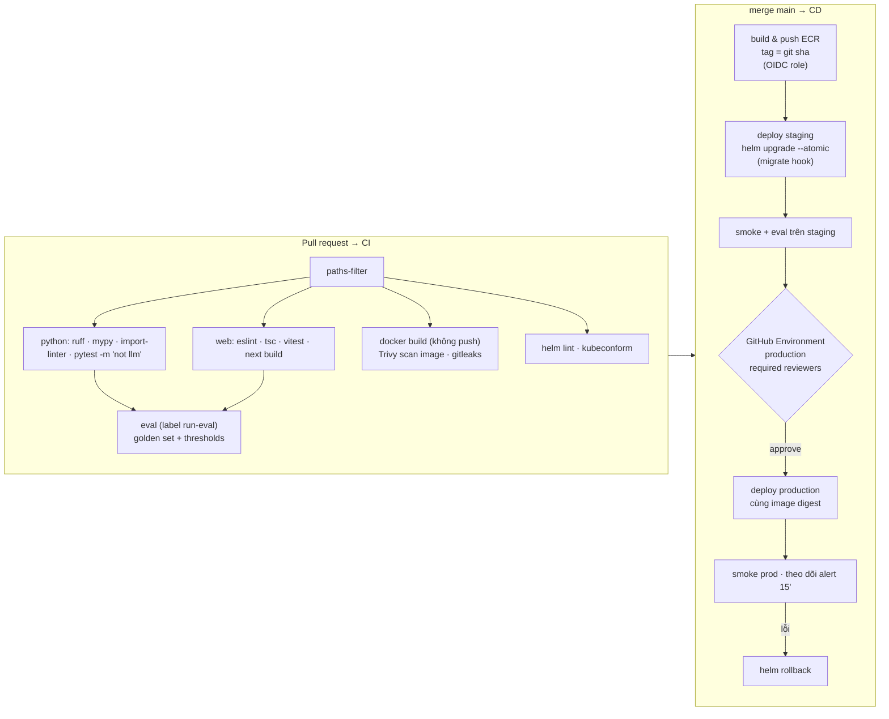

| Điểm | Chi tiết |
|---|---|
| Xác thực AWS | `aws-actions/configure-aws-credentials` với **OIDC** (`id-token: write`), IAM role giới hạn theo repo + branch/environment |
| Image | Build một lần, **promote cùng digest** từ staging lên prod; multi-arch nếu node Graviton |
| Branch protection | `main` yêu cầu CI xanh + 1 review; Dependabot cho uv/pnpm/actions/docker |
| Secret | Chỉ để trong AWS Secrets Manager; GitHub chỉ có role ARN. `OPENAI_API_KEY` cho eval dùng key riêng có budget thấp |
| Migration | Alembic chạy trong Helm hook; migration phải backward-compatible (expand → migrate → contract) để rollback an toàn |
| Tiến hoá | Khi có nhiều môi trường/cluster → chuyển sang **ArgoCD** (GitOps): Actions chỉ build + cập nhật tag trong repo `deploy/` |

Skeleton `.github/workflows/cd.yml`:

```yaml
name: CD
on: { push: { branches: [main] } }
permissions: { id-token: write, contents: read }
jobs:
  build:
    runs-on: ubuntu-latest
    strategy: { matrix: { app: [gateway, ai-service, web] } }
    steps:
      - uses: actions/checkout@v4
      - uses: aws-actions/configure-aws-credentials@v4
        with: { role-to-assume: "${{ vars.AWS_DEPLOY_ROLE }}", aws-region: ap-southeast-1 }
      - uses: aws-actions/amazon-ecr-login@v2
      - run: |
          docker build -f apps/${{ matrix.app }}/Dockerfile -t $ECR/${{ matrix.app }}:${{ github.sha }} .
          docker push $ECR/${{ matrix.app }}:${{ github.sha }}
  deploy-staging:
    needs: build
    environment: staging
    runs-on: ubuntu-latest
    steps:
      - uses: actions/checkout@v4
      - uses: aws-actions/configure-aws-credentials@v4
        with: { role-to-assume: "${{ vars.AWS_DEPLOY_ROLE }}", aws-region: ap-southeast-1 }
      - run: aws eks update-kubeconfig --name company-brain-staging
      - run: helm upgrade --install cb deploy/helm/company-brain -f deploy/values-staging.yaml --set image.tag=${{ github.sha }} --atomic --timeout 10m
      - run: ./scripts/smoke.sh https://staging.lumi.example.com
  deploy-prod:
    needs: deploy-staging
    environment: production        # required reviewers
    runs-on: ubuntu-latest
    steps: [ "… như staging với values-prod.yaml, cluster company-brain-prod …" ]
```

---

## 7. Amazon EKS — scale worker, lưu trữ S3

### 7.1 Workload

| Workload | Kiểu | Scale | Ghi chú |
|---|---|---|---|
| web | Deployment | HPA CPU, min 2 | Next.js standalone |
| gateway | Deployment | HPA theo CPU + `sse_connections`, min 2 | SSE giữ kết nối lâu → giới hạn connection/pod; `terminationGracePeriodSeconds` đủ để client reconnect |
| ai-worker | Deployment | **KEDA** theo queue, min 1 (hoặc 0 ngoài giờ), max 20 | `terminationGracePeriodSeconds: 35` > `SHUTDOWN_GRACE_S=25`; I/O-bound → `WORKER_CONCURRENCY=4–8`/pod |
| outbox-relay | Deployment 1 replica | — | Hoặc gộp vào gateway với advisory lock |
| ingest | Job / CronJob | theo sự kiện | Trigger từ S3 event → SQS → job, hoặc admin bấm |
| LiteLLM | Deployment ×2 | HPA | Stateless, state ở RDS |
| Qdrant | StatefulSet ×3 | thủ công | EBS gp3, replication factor 2, snapshot định kỳ → S3 |

KEDA `ScaledObject` cho worker (sau khi chuyển sang Streams):

```yaml
apiVersion: keda.sh/v1alpha1
kind: ScaledObject
metadata: { name: ai-worker, namespace: company-brain }
spec:
  scaleTargetRef: { name: ai-worker }
  minReplicaCount: 1
  maxReplicaCount: 20
  cooldownPeriod: 300
  triggers:
    - type: redis-streams
      metadata:
        addressFromEnv: REDIS_ADDRESS
        enableTLS: "true"
        stream: stream:jobs
        consumerGroup: ai-workers
        pendingEntriesCount: "8"     # ≈ WORKER_CONCURRENCY × 2 job chờ / pod
```

Node: **Karpenter** với 3 nhóm — `system` (on-demand), `app` (on-demand), `worker` (cho phép Spot: job có
ack + XAUTOCLAIM nên pod bị thu hồi không mất job). PodDisruptionBudget cho gateway/web/Qdrant.
NetworkPolicy: chỉ worker gọi LiteLLM; chỉ LiteLLM ra Internet (NAT) tới OpenAI.

### 7.2 S3

| Bucket / prefix | Dùng cho | Chính sách |
|---|---|---|
| `cb-kb-raw` | Tài liệu gốc (Markdown/PDF/Docx) — nguồn của ingest | Versioning on, event `ObjectCreated` → SQS → ingest job |
| `cb-artifacts` | Brief đã xuất `.md/.pdf`, link tải có presigned URL | Lifecycle → IA sau 90 ngày |
| `cb-qdrant-snapshots` | Snapshot Qdrant | Giữ 14 bản |
| `cb-loki` | Chunk + index Loki | Lifecycle 30–90 ngày |
| `cb-langfuse` | Langfuse event upload + media | Theo chính sách dữ liệu |
| `cb-backups` | Export RDS bổ sung, eval report | Object Lock nếu cần audit |

Truy cập bằng **EKS Pod Identity / IRSA** (mỗi ServiceAccount một IAM role, chỉ bucket cần dùng), mã hoá SSE-KMS,
block public access, VPC gateway endpoint cho S3 (không đi qua NAT).

---

## 8. NGINX & tên miền — cần cấu hình gì thêm

Có, ngoài "trỏ domain vào NGINX" còn các việc sau, phần lớn do **SSE** và do frontend hiện **bake URL gateway lúc build**.

### 8.1 DNS & TLS

| Việc | Chi tiết |
|---|---|
| Hosted zone Route 53 | Mua/ủy quyền `lumi.example.com` về Route 53 (NS record ở nhà đăng ký) |
| Record | `app.lumi.example.com` → NLB (ALIAS). `ops.lumi.example.com` (Grafana, Langfuse) → NLB nội bộ hoặc sau SSO/VPN |
| Tự động | **ExternalDNS** đọc host trong Ingress/Gateway và tạo record |
| Chứng chỉ | **cert-manager** + Let's Encrypt (DNS-01 qua Route 53), hoặc ACM gắn ở NLB (TLS termination tại NLB) |
| HSTS | Bật sau khi đã chắc TLS ổn định |

### 8.2 Same-origin thay vì 2 domain

Hiện tại web gọi `NEXT_PUBLIC_GATEWAY_URL=http://localhost:8080` (bake lúc build) và gateway bật CORS.
Production nên route **cùng domain**: `app.lumi.example.com/` → web, `app.lumi.example.com/api/` → gateway (strip
prefix). Lợi ích: không CORS, cookie session `SameSite=Strict` dùng được, một chứng chỉ, và
`NEXT_PUBLIC_GATEWAY_URL=/api` không phụ thuộc môi trường → một image web dùng cho staging và prod.

### 8.3 Cấu hình NGINX bắt buộc cho SSE

Gateway đã gửi `X-Accel-Buffering: no` và heartbeat mỗi 15 s; NGINX vẫn cần:

```nginx
location /api/ {
    proxy_pass http://gateway:8080/;          # strip /api
    proxy_http_version 1.1;
    proxy_set_header Connection "";           # keep-alive tới upstream
    proxy_set_header Host $host;
    proxy_set_header X-Request-ID $request_id;
    proxy_set_header X-Forwarded-For $proxy_add_x_forwarded_for;
    proxy_set_header X-Forwarded-Proto $scheme;

    client_max_body_size 1m;
    limit_req zone=api burst=20 nodelay;      # lớp rate limit đầu (theo IP)
}

location ~ ^/api/v1/jobs/[^/]+/events$ {
    proxy_pass http://gateway:8080;
    rewrite ^/api/(.*)$ /$1 break;
    proxy_http_version 1.1;
    proxy_set_header Connection "";
    proxy_buffering off;                      # không gom event
    proxy_cache off;
    gzip off;                                 # gzip làm event bị giữ lại trong buffer
    proxy_read_timeout 1h;                    # > thời gian job tối đa; heartbeat 15s giữ kết nối
    proxy_send_timeout 1h;
    proxy_set_header Last-Event-ID $http_last_event_id;
}

add_header X-Content-Type-Options nosniff always;
add_header Referrer-Policy strict-origin-when-cross-origin always;
add_header Content-Security-Policy "default-src 'self'; connect-src 'self'; img-src 'self' data:" always;
add_header Strict-Transport-Security "max-age=31536000; includeSubDomains" always;
```

Các điểm khác cần chú ý:

- **Idle timeout của load balancer**: NLB 350 s (TCP) — ổn vì heartbeat 15 s; nếu dùng ALB, đặt idle timeout ≥ 60 s.
- **Client IP thật**: bật proxy protocol giữa NLB và NGINX (`real_ip_header proxy_protocol`) để rate limit theo IP đúng.
- **Graceful shutdown**: khi rollout gateway, SSE bị cắt → client tự reconnect với `Last-Event-ID` (đã hỗ trợ), nên
  chỉ cần `preStop` sleep vài giây để NGINX rút pod khỏi upstream trước.
- **Controller**: dự án community `kubernetes/ingress-nginx` đã ngừng phát triển (retired 03/2026) → dùng
  **F5 NGINX Ingress Controller** hoặc **NGINX Gateway Fabric** (Gateway API). Các directive trên giữ nguyên ý nghĩa,
  chỉ khác cách khai báo (annotation / policy CRD).
- **WAF**: NLB không gắn được AWS WAF. Cần WAF → đặt CloudFront + WAF phía trước (lưu ý CloudFront origin read
  timeout cho SSE), hoặc dùng ALB thay NLB, hoặc ModSecurity/NGINX App Protect trong NGINX.
- **Trang ops** (Grafana, Langfuse, Qdrant dashboard, LiteLLM UI): không mở public; dùng SSO (oauth2-proxy) hoặc chỉ
  truy cập qua VPN.

---

## 9. Bảo mật production (bổ sung)

| Hạng mục | Thay đổi |
|---|---|
| Auth | Basic Auth + `sessionStorage` → **OIDC** (Google Workspace hoặc Cognito); gateway cấp session cookie httpOnly/Secure/SameSite; RBAC từ group IdP |
| Rate limit / quota | NGINX (theo IP) + gateway (token bucket Lua theo user, concurrency theo user) + LiteLLM budget |
| Secrets | Secrets Manager → External Secrets Operator → K8s Secret; xoay vòng key định kỳ |
| Phân quyền tài liệu | Payload `allowed_groups` trong Qdrant + filter theo group của user; RLS trong Postgres |
| Dữ liệu ra ngoài | PII redaction trước LLM và trước Langfuse; xem xét OpenAI zero-data-retention |
| Supply chain | Pin image digest, Trivy scan, gitleaks, Dependabot, ký image (cosign) |
| Audit | Bảng `audit_log` cho ingest, đổi rule, xuất artifact |

---

## 10. Lộ trình triển khai

| Giai đoạn | Nội dung | Kết quả |
|---|---|---|
| **P0 — Tin cậy & quan sát được** | Redis Streams + ack + DLQ; Langfuse tracing (CallbackHandler); LiteLLM proxy + cost; Prometheus metrics trong gateway/worker; rate limit theo user | Không mất job; biết mỗi câu trả lời tốn bao nhiêu và chạy qua những gì |
| **P1 — Dữ liệu bền** | PostgreSQL (schema app/conv/lg), Alembic, outbox, `AsyncPostgresSaver`; KB lên S3 + ingest theo event | Redis chỉ còn là transport/cache |
| **P2 — Lên AWS** | Terraform: VPC, EKS, RDS, ElastiCache, S3, ECR, Route 53; Helm chart; NGINX + cert-manager + ExternalDNS; KEDA; Loki/Grafana; CD qua GitHub Actions OIDC; OIDC login | Staging + production chạy được, deploy bằng merge + approve |
| **P3 — Chất lượng & mở rộng** | Reranker; thêm skill (insight summary, campaign recommendation); human-in-the-loop bằng `interrupt()`; ACL tài liệu; online eval trên Langfuse; ArgoCD | Sẵn sàng nhiều team / nhiều brand |
